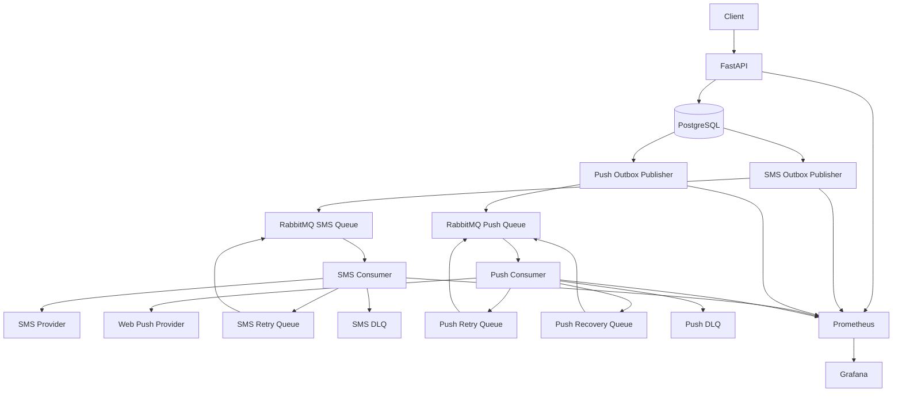

# NotifyFlow
A scalable, event-driven notification platform for asynchronous SMS
and Web Push delivery.

NotifyFlow is a backend notification system built with FastAPI,
PostgreSQL, RabbitMQ, and Python workers. It uses asynchronous message
processing, transactional outbox publishing, retry queues, dead-letter
queues, and idempotency to improve reliability.
## 🚀 Features
- REST APIs built with FastAPI.
- Asynchronous SMS notification processing.
- Browser Web Push notifications using VAPID.
- PostgreSQL persistence with SQLAlchemy and Alembic.
- RabbitMQ-based message processing.
- Transactional outbox pattern.
- Publisher confirms for reliable message publishing.
- Retry queues and dead-letter queues.
- Idempotent notification processing.
- SMS delivery receipt handling.
- Push subscription and delivery tracking.
- Push notification recovery for interrupted processing.
- Prometheus metrics.
- Grafana dashboards and alert rules.
- Configurable mock SMS provider for failure testing.
- Dockerized application services using Docker Compose.
- Automated tests using Pytest.
## 🏗️ Architecture
NotifyFlow separates API request handling from notification delivery.

The API persists notifications and outbox events in PostgreSQL.
Dedicated publishers transfer pending events to RabbitMQ. Independent
consumers process SMS and Web Push messages through their respective
providers.

### Technology Stack
Component	Technology
Language	Python
API framework	FastAPI
Database	PostgreSQL
ORM	SQLAlchemy
Database migrations	Alembic
Message broker	RabbitMQ
RabbitMQ client	aio-pika
SMS provider	MSG91 / Mock Provider
Web Push	pywebpush / VAPID
Metrics	Prometheus
Dashboards	Grafana
Validation	Pydantic
Testing	Pytest
Containerization	Docker and Docker Compose

## 🔄 Notification Workflows
### SMS Pipeline
1. Client submits an SMS request to FastAPI.
2. API persists the notification and its outbox event.
3. SMS outbox publisher claims pending events.
4. Publisher sends events to RabbitMQ and waits for broker
   confirmation.
5. SMS consumer processes the message.
6. Configured SMS provider handles the delivery request.
7. Transient failures enter the delayed retry queue.
8. Invalid or exhausted messages are routed to the dead-letter queue.
9. Delivery receipts update notification status.
SMS queues
Queue	Purpose
notifyflow.notifications	Main queue
notifyflow.retry	Delayed retry queue
notifyflow.dlq	Dead-letter queue

The SMS retry delay is 5 seconds, with a maximum of three processing
attempts.

The mock provider supports configurable transient failures to test retry
behavior.
### Web Push Pipeline
1. Browser subscription details are registered through the API.
2. Client submits a push notification.
3. PostgreSQL stores the notification and outbox event atomically.
4. Push outbox publisher publishes the event.
5. Push consumer processes the event.
6. Consumer fans out the notification to registered, non-expired
   subscriptions.
7. Delivery results are tracked for individual subscriptions.
8. Eligible failures are retried.
9. Expired subscriptions are marked accordingly.
10. Failed events are isolated in the push dead-letter queue.
Web Push queues
Queue	Purpose
notifyflow.push.notifications	Main queue
notifyflow.push.retry	Delayed retry queue
notifyflow.push.recovery	Interrupted-processing recovery
notifyflow.push.dlq	Dead-letter queue

Push processing uses a maximum of three normal retry attempts.

A processing lease of 120 seconds and a recovery delay of 125 seconds
help recover notifications interrupted during processing.
## 🛡️ Reliability and Idempotency
### Transactional Outbox
Notification records and their corresponding outbox events are persisted
in the same database transaction.

This prevents a notification from being committed without its publishing
event being recorded.

Dedicated publishers transfer pending outbox events to RabbitMQ using
publisher confirmations.
### Idempotency
The Push API supports the Idempotency-Key request header.
- Repeated requests with the same key and payload return the existing
  notification.
- Reusing the same key with a different payload returns HTTP 409.
- PostgreSQL conflict handling prevents duplicate notification and
  outbox creation.
The SMS consumer uses an inbox/idempotency mechanism and a stable
provider idempotency key to help prevent duplicate processing and
provider submissions.
### Retry and Recovery
- Transient provider failures are retried.
- Retry queues use a 5-second delay.
- Messages exceeding the configured retry limit are isolated in
  dead-letter queues.
- Push processing uses delivery records and leases to recover
  interrupted work.
- Publisher confirms ensure the original RabbitMQ message is
  acknowledged only after successful forwarding.
## 📡 API Reference
The following endpoints are available:
Method	Endpoint	Purpose
GET	/	Root endpoint
GET	/health	Health check
GET	/metrics	Prometheus metrics
POST	/notifications	Submit SMS notification
GET	/notifications	Retrieve notifications
GET	/notifications/{notification_id}	Retrieve notification details
POST	/webhooks/dlr	SMS delivery receipt webhook
POST	/push/subscriptions	Register or update a push subscription
POST	/push/notifications	Submit a Web Push notification

Interactive API documentation:
- Swagger UI: http://localhost:8000/docs
- ReDoc: http://localhost:8000/redoc
### Web Push Request Example
curl -X POST http://localhost:8000/push/notifications \
  -H "Content-Type: application/json" \
  -H "Idempotency-Key: notifyflow-demo-001" \
  -d '{
    "title": "NotifyFlow Demo",
    "body": "Your notification has arrived!",
    "target_url": "/"
  }'
The API returns HTTP 202 when the request is accepted for asynchronous
processing.

Example response:
{
  "id": 21,
  "title": "NotifyFlow Demo",
  "body": "Your notification has arrived!",
  "target_url": "/",
  "status": "queued",
  "duplicate": false
}
The notification status is updated as background processing progresses.
## 📊 Monitoring and Observability
NotifyFlow exposes Prometheus metrics for API and worker activity.

Monitoring covers:
- API request counts and latency.
- Notification processing duration.
- SMS and push delivery results.
- Provider attempts.
- Consumer errors.
- Retry and dead-letter events.
- Queue activity.
- Worker processing behavior.
Grafana provides dashboards and configured alert rules for operational
visibility.
### Benchmark Results
Local API benchmark results using:
- 2,000 requests per measured run.
- 20 concurrent requests.
- 20 warm-up requests excluded from measured results.
- Three measured runs.
- PostgreSQL connection pool size: 15.
- Maximum overflow connections: 0.
- Pool timeout: 30 seconds.
Three-run median results
Metric	Result
Throughput	324.49 requests/second
Average latency	61.33 ms
p50 latency	61.26 ms
p95 latency	78.10 ms
p99 latency	88.65 ms
HTTP 202 acceptance	100%

Each measured run achieved 2,000 successful HTTP 202 responses.
### Baseline Comparison
Compared with an earlier benchmark session using the same request count
and concurrency:
Metric	Earlier baseline	Later benchmark
Throughput	198.95 req/s	324.49 req/s
p95 latency	147.603 ms	78.10 ms

Observed differences:
- Throughput: 63.10% higher.
- p95 latency: 47.09% lower.
These are observed differences between benchmark sessions. They do not
establish that the connection-pool configuration alone caused the
improvement.

Benchmark limitations
- Tests ran in a local development environment, not production.
- HTTP 202 means API acceptance, not confirmed SMS or push delivery.
- Hardware specifications and resource utilization were not recorded.
- The benchmark does not establish production capacity.
See the [detailed benchmark
report](benchmarks/NOTIFYFLOW_BENCHMARK_REPORT.md).
## 🧪 Testing
The project includes automated tests for:
- API endpoints.
- Notification processing.
- SMS provider integration.
- Push API and subscription validation.
- Push consumer behavior.
- Retry and recovery scenarios.
- Provider factories.
- Metrics.
Latest recorded full regression test result: 107 passed, 1 warning.

Run the test suite:
PYTHONPATH=. pytest -v
The existing test warning relates to a Starlette/httpx deprecation
notice; it did not cause a test failure.
## ⚙️ Configuration
NotifyFlow loads settings from environment variables and a local .env
file.
Variable	Purpose
DATABASE_URL	PostgreSQL connection URL
POSTGRES_PASSWORD	Docker PostgreSQL application password
WEB_PUSH_TTL_SECONDS	Web Push message time-to-live
WEB_PUSH_TIMEOUT_SECONDS	Web Push provider timeout
SMS_PROVIDER	SMS provider selection
MSG91_AUTH_KEY	MSG91 authentication
MSG91_TEMPLATE_ID	MSG91 template
VAPID_PRIVATE_KEY_PATH	Web Push private key path; host path used for Docker mounting
VAPID_PUBLIC_KEY	Web Push public key
VAPID_SUBJECT	VAPID subject
DLR_WEBHOOK_SECRET	Delivery receipt webhook secret
RABBITMQ_HOST	RabbitMQ hostname
RABBITMQ_PORT	RabbitMQ port
RABBITMQ_USERNAME	RabbitMQ username
RABBITMQ_PASSWORD	RabbitMQ password
RABBITMQ_VHOST	RabbitMQ virtual host

For Docker Compose, configure POSTGRES_PASSWORD, RabbitMQ credentials,
DLR_WEBHOOK_SECRET, and the host-side VAPID_PRIVATE_KEY_PATH in the
root .env file. The Compose network supplies the container database
and RabbitMQ addresses.

Never commit .env, provider credentials, VAPID private keys, or other
secrets.
## 🐳 Docker Deployment
NotifyFlow can run as a multi-container application using Docker
Compose. The application stack defines eight services:
Service	Responsibility
postgres	Persistent PostgreSQL database
rabbitmq	Message broker
init	Runs database migrations and initializes RabbitMQ queues
api	FastAPI application
sms-consumer	Processes SMS messages
sms-publisher	Publishes SMS outbox events
push-consumer	Processes Web Push messages
push-publisher	Publishes Web Push outbox events

### Prerequisites
- Docker Engine.
- Docker Compose v2.
- A root .env file with the required configuration.
- A VAPID private key file for the push consumer.
### 1. Clone the repository
git clone https://github.com/ishan4432/notifyflow.git
cd notifyflow
### 2. Configure environment variables
Create a .env file in the project root. Configure these required
values:
POSTGRES_PASSWORD=replace_with_a_strong_password

RABBITMQ_USERNAME=notifyflow_app
RABBITMQ_PASSWORD=replace_with_a_strong_password
RABBITMQ_VHOST=notifyflow

DLR_WEBHOOK_SECRET=replace_with_a_long_random_secret

VAPID_PRIVATE_KEY_PATH=/absolute/host/path/to/private_key.pem
VAPID_PUBLIC_KEY=replace_with_your_vapid_public_key
VAPID_SUBJECT=mailto:admin@example.com
Use strong, unique values. Replace the VAPID path with the absolute path
to the private key on the Docker host. The push consumer mounts this
file read-only.

Add provider-specific settings if using a real SMS provider. The mock
SMS provider is the default for local pipeline testing.

Do not commit .env or share real credentials.
### 3. Build and start the application
From the repository root:
docker compose -f docker-compose.yml up -d --build
The initialization service waits for PostgreSQL and RabbitMQ health
checks, then:
1. Applies database migrations using alembic upgrade head.
2. Initializes the SMS RabbitMQ queues.
3. Initializes the Web Push RabbitMQ queues.
The API and worker services start after initialization completes
successfully.
### 4. Verify running services
docker compose -f docker-compose.yml ps
Inspect API logs:
docker compose -f docker-compose.yml logs -f api
Inspect an individual worker:
docker compose -f docker-compose.yml logs -f sms-consumer
### 5. Verify the API
curl http://127.0.0.1:8000/health
Interactive API documentation:
- Swagger UI: http://localhost:8000/docs
- ReDoc: http://localhost:8000/redoc
The API and worker metrics ports are bound to 127.0.0.1 on the host.
PostgreSQL and RabbitMQ are available to application containers through
the internal Compose network and are not published on host ports by this
Compose file.
### 6. Submit a test SMS notification
curl -X POST http://127.0.0.1:8000/notifications \
  -H "Content-Type: application/json" \
  -H "Idempotency-Key: docker-demo-001" \
  -d '{
    "to": "+919999999999",
    "message": "NotifyFlow Docker smoke test"
  }'
The API returns HTTP 202 when the notification is accepted for
asynchronous processing.

With the mock provider, the consumer simulates provider acceptance. This
verifies the Dockerized processing pipeline; it does not send an actual
SMS to a phone. Configure a real SMS provider and its credentials to
test real provider submission.
### 7. Start Prometheus and Grafana
The monitoring stack is managed separately from the application stack.
Configure monitoring/grafana.env locally before starting it.
docker compose -f docker-compose.monitoring.yml up -d
Monitoring interfaces:
- Prometheus: http://localhost:9090
- Grafana: http://localhost:3000
Prometheus is configured to scrape the API and all four
publisher/consumer metrics endpoints.
### 8. Persistent storage
The application Compose file uses named volumes:
- notifyflow-app-postgres-data
- notifyflow-app-rabbitmq-data
These volumes retain PostgreSQL and RabbitMQ data across container
recreation. Avoid docker compose down -v unless you intentionally want
to delete persistent application data.
### 9. Stop and restart the application
Stop the application services:
docker compose -f docker-compose.yml stop
Start them again:
docker compose -f docker-compose.yml start
The monitoring stack is separate and must be managed using
docker-compose.monitoring.yml.
## 🚀 Local Development
### Prerequisites
- Python 3.14 (development environment).
- PostgreSQL.
- RabbitMQ.
- Docker and Docker Compose for monitoring.
Other Python versions have not yet been validated.
### 1. Clone the repository
git clone https://github.com/ishan4432/notifyflow.git
cd notifyflow
### 2. Create a virtual environment
python -m venv .venv
source .venv/bin/activate
### 3. Install dependencies
pip install -r requirements.txt
### 4. Configure environment variables
Create a local .env file containing the required database, RabbitMQ,
webhook, and provider settings.

Configure VAPID credentials and the SMS provider according to the
selected provider.
### 5. Run database migrations
alembic upgrade head
### 6. Configure RabbitMQ queues
python scripts/setup_rabbitmq.py
python scripts/setup_push_rabbitmq.py
### 7. Start the API
uvicorn app.main:app --reload
### 8. Start consumers and publishers
Run each command in a separate terminal with the virtual environment
activated.

SMS consumer
PYTHONPATH=. python -m scripts.consumer
Push consumer
PYTHONPATH=. python -m scripts.push_consumer
SMS outbox publisher
PYTHONPATH=. python -m scripts.outbox_publisher
Push outbox publisher
PYTHONPATH=. python -m scripts.push_outbox_publisher
Ensure PostgreSQL and RabbitMQ are running and configured before
starting the services.
### 9. Start monitoring
The monitoring Compose file starts Prometheus and Grafana. It does not
start PostgreSQL or RabbitMQ.

Configure monitoring/grafana.env locally before starting the stack.
docker compose -f docker-compose.monitoring.yml up -d
Monitoring interfaces:
- Prometheus: http://localhost:9090
- Grafana: http://localhost:3000
## 📁 Project Structure
notifyflow/
├── app/
│   ├── providers/
│   ├── routers/
│   ├── database.py
│   ├── main.py
│   ├── metrics.py
│   ├── models.py
│   ├── push_schemas.py
│   ├── schemas.py
│   └── worker_metrics.py
├── benchmarks/
│   ├── NOTIFYFLOW_BENCHMARK_REPORT.md
│   └── generate_report.py
├── migrations/
│   └── versions/
├── monitoring/
│   ├── grafana/
│   │   ├── dashboards/
│   │   └── provisioning/
│   └── prometheus.yml
├── scripts/
│   ├── consumer.py
│   ├── outbox_publisher.py
│   ├── push_consumer.py
│   ├── push_outbox_publisher.py
│   ├── setup_rabbitmq.py
│   └── setup_push_rabbitmq.py
├── tests/
├── .dockerignore
├── .gitignore
├── Dockerfile
├── docker-compose.yml
├── docker-compose.monitoring.yml
├── alembic.ini
├── requirements.txt
└── README.md
## 🛠️ Future Improvements
- Kubernetes deployment and orchestration.
- Production-scale load testing and resource monitoring.
- Expanded operational dashboards and alert validation.
- End-to-end integration testing with real SMS provider environments.
- Automated deployment and CI/CD workflows.
- Production secret management and deployment hardening.
## 👨‍💻 Author
Ishan Verma
- GitHub: @ishan4432
- Repository: NotifyFlow
NotifyFlow — Reliable, asynchronous notification delivery through
event-driven architecture.
