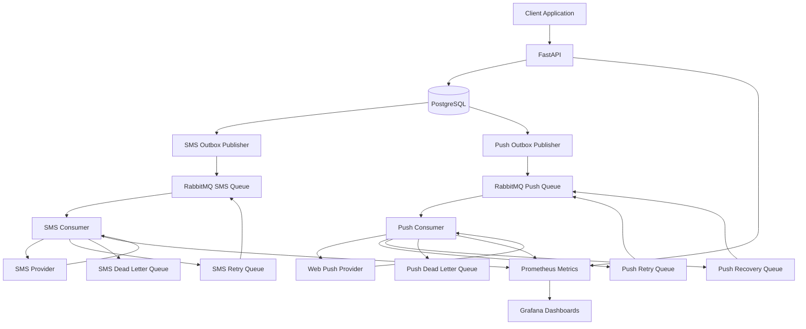

# NotifyFlow 🚀

### Scalable, Event-Driven Notification Platform

NotifyFlow is an asynchronous notification delivery platform built with **FastAPI, PostgreSQL, RabbitMQ, and Python**. It supports SMS notifications and browser Web Push notifications through independent processing pipelines.

The system is designed around reliable event publishing, asynchronous processing, retry handling, idempotency, delivery tracking, and observability.

## ✨ Features

- **SMS Notifications:** Submit SMS notifications through a REST API.
- **Web Push Notifications:** Register browser subscriptions and send push notifications.
- **Asynchronous Processing:** Process notifications using independent background workers.
- **Transactional Outbox:** Persist notification events and publish them to RabbitMQ reliably.
- **Publisher Confirms:** Wait for RabbitMQ broker confirmation before marking events as published.
- **Retry Mechanism:** Retry transient failures using delayed RabbitMQ queues.
- **Dead Letter Queue:** Isolate permanently failed or invalid messages.
- **Idempotency:** Prevent duplicate notification creation when requests are retried.
- **Delivery Receipts:** Process SMS delivery status callbacks.
- **Observability:** Export application and worker metrics to Prometheus and visualize them in Grafana.
- **Database Migrations:** Manage schema changes using Alembic.

## 🏗️ Architecture



### Technology Stack

| Component | Technology |
|---|---|
| API framework | FastAPI |
| Programming language | Python |
| Database | PostgreSQL |
| ORM | SQLAlchemy |
| Database migrations | Alembic |
| Message broker | RabbitMQ |
| Async messaging | aio-pika |
| SMS integration | MSG91 / Mock Provider |
| Browser notifications | Web Push / VAPID |
| Metrics | Prometheus |
| Dashboards and alerts | Grafana |
| Validation and testing | Pydantic / Pytest |
| HTTP client | HTTPX |

## 🔄 Notification Lifecycle

### SMS Pipeline

1. Client submits an SMS request to the FastAPI endpoint.
2. The API validates the request and persists the notification and outbox event.
3. The SMS outbox publisher claims pending events.
4. The publisher sends events to RabbitMQ and waits for broker confirmation.
5. The SMS consumer retrieves and processes the message.
6. The configured SMS provider handles the delivery request.
7. Transient failures are routed through the retry queue.
8. Permanently invalid or exhausted messages are moved to the dead letter queue.
9. Delivery receipts update the notification status.

**SMS RabbitMQ queues**

| Queue | Purpose |
|---|---|
| `notifyflow.notifications` | Main notification queue |
| `notifyflow.retry` | Delayed retry queue |
| `notifyflow.dlq` | Dead letter queue |

The SMS retry queue uses a 5-second message TTL, and the consumer is configured for a maximum of three attempts.

### Web Push Pipeline

1. Browser subscription details are registered through the API.
2. A client submits a push notification.
3. PostgreSQL stores the notification and its outbox event atomically.
4. The push outbox publisher publishes the event to RabbitMQ.
5. The push consumer retrieves the event.
6. The consumer fans out the notification to registered, non-expired subscriptions.
7. Delivery results are tracked, with retry and recovery handling for eligible failures.
8. Failed events are isolated in the push dead letter queue.

**Push RabbitMQ queues**

| Queue | Purpose |
|---|---|
| `notifyflow.push.notifications` | Main push queue |
| `notifyflow.push.retry` | Delayed retry queue |
| `notifyflow.push.recovery` | Delivery lease recovery queue |
| `notifyflow.push.dlq` | Dead letter queue |

The push retry and recovery queues use a 5-second retry delay and a recovery delay based on a 120-second delivery lease.

## 🔐 Reliability and Design Concepts

### Transactional Outbox Pattern

Notification creation and outbox event creation happen in the same PostgreSQL transaction.

This prevents a notification from being committed without its corresponding event being persisted.

Separate publisher processes publish pending events to RabbitMQ. Events are marked published after broker confirmation.

### Idempotency

The push notification API supports an `Idempotency-Key` header.

- Repeated requests with the same key and payload return the existing notification.
- Reusing the same key with a different payload returns HTTP 409.
- PostgreSQL conflict handling protects against concurrent duplicate requests.

### Consumer Inbox

The SMS consumer uses a consumer inbox table with a unique event identifier to help prevent duplicate event processing.

### Retry and Dead Letter Handling

Transient failures are handled through delayed retry queues. Permanently invalid messages and messages that exhaust their retry attempts are routed to dead letter queues.

## 📡 API Endpoints

### Core API

| Method | Endpoint | Description |
|---|---|---|
| GET | `/` | Root endpoint |
| GET | `/health` | Health check |
| GET | `/metrics` | Prometheus metrics |
| POST | `/notifications` | Submit SMS notification |
| GET | `/notifications` | List notifications |
| GET | `/notifications/{notification_id}` | Get notification details |
| POST | `/webhooks/dlr` | Receive SMS delivery receipts |

### Push API

| Method | Endpoint | Description |
|---|---|---|
| POST | `/push/subscriptions` | Register or update browser subscription |
| POST | `/push/notifications` | Create a push notification |

### Example: Submit SMS

`POST /notifications`

```json
{
  "to": "+919876543210",
  "message": "Hello from NotifyFlow!",
  "priority": "normal"
}
```

The API accepts low, normal, and high priorities.

Successful asynchronous submission returns HTTP `202 Accepted`.

### Example: Register Push Subscription

`POST /push/subscriptions`

```json
{
  "endpoint": "https://push-service.example/subscription",
  "keys": {
    "p256dh": "BASE64URL_PUBLIC_KEY",
    "auth": "BASE64URL_AUTH_SECRET"
  }
}
```

Use the actual endpoint and keys generated by the browser's Push API. The example values above are placeholders.

### Example: Create Push Notification

`POST /push/notifications`

Header:

```http
Idempotency-Key: notification-unique-001
```

Request:

```json
{
  "title": "NotifyFlow",
  "body": "Your notification has arrived!",
  "target_url": "/"
}
```

The API returns HTTP `202 Accepted` for a newly queued notification.

## 📊 Monitoring and Observability

NotifyFlow uses Prometheus and Grafana to monitor application and consumer behavior.

### Monitoring Stack

- Prometheus for metric collection and time-series storage.
- Grafana for dashboards and alert visualization.
- Application metrics exposed through `/metrics`.
- Separate worker metrics endpoints.
- Grafana provisioning for dashboards and data sources.

### Metrics and Reliability Signals

The monitoring implementation includes metrics for:

- SMS and Push delivery results.
- Consumer processing duration.
- Consumer errors.
- Dead letter queue events.
- Provider attempts.
- Notification processing activity.

Additional performance evaluation will cover throughput, p50/p95/p99 latency, failure rates, retry rates, queue lag, and resource consumption.

Performance figures will be published only after reproducible benchmark runs.

## 🧪 Testing

The project includes Pytest coverage for:

- API endpoints.
- Notification processing.
- SMS provider integration.
- Push API and subscription validation.
- Push consumer behavior.
- Metrics.
- Provider factories.

Run tests:

```bash
pytest -v
```

## ⚙️ Configuration

NotifyFlow reads configuration from environment variables and a local `.env` file.

Important settings include:

| Variable | Purpose |
|---|---|
| `DATABASE_URL` | PostgreSQL connection URL |
| `SMS_PROVIDER` | SMS provider selection |
| `MSG91_AUTH_KEY` | MSG91 authentication |
| `MSG91_TEMPLATE_ID` | MSG91 template configuration |
| `VAPID_PRIVATE_KEY_PATH` | Web Push private key path |
| `VAPID_PUBLIC_KEY` | Web Push public key |
| `VAPID_SUBJECT` | VAPID subject |
| `DLR_WEBHOOK_SECRET` | Delivery receipt webhook secret |
| `RABBITMQ_HOST` | RabbitMQ hostname |
| `RABBITMQ_PORT` | RabbitMQ port |
| `RABBITMQ_USERNAME` | RabbitMQ username |
| `RABBITMQ_PASSWORD` | RabbitMQ password |
| `RABBITMQ_VHOST` | RabbitMQ virtual host |

Never commit `.env`, credentials, private keys, or provider secrets.

## 🚀 Local Development

### Prerequisites

- Python 3.12 or compatible Python version.
- PostgreSQL.
- RabbitMQ.
- Docker and Docker Compose for the monitoring stack.

### 1. Clone the repository

```bash
git clone https://github.com/ishan4432/notifyflow.git
cd notifyflow
```

### 2. Create a virtual environment

```bash
python -m venv .venv
source .venv/bin/activate
```

### 3. Install dependencies

```bash
pip install -r requirements.txt
```

### 4. Configure environment variables

Create a local `.env` file with the required database, RabbitMQ, webhook, and provider configuration.

Do not use real production credentials in public examples.

### 5. Run database migrations

```bash
alembic upgrade head
```

### 6. Configure RabbitMQ queues

```bash
python scripts/setup_rabbitmq.py
python scripts/setup_push_rabbitmq.py
```

### 7. Start the API

```bash
uvicorn app.main:app --reload
```

API documentation:

- Swagger UI: `http://localhost:8000/docs`
- ReDoc: `http://localhost:8000/redoc`

### 8. Start the consumers and publishers

Run each process in a separate terminal:

```bash
python -m scripts.consumer
```

```bash
python -m scripts.push_consumer
```

```bash
python -m scripts.outbox_publisher
```

```bash
python -m scripts.push_outbox_publisher
```

Ensure PostgreSQL and RabbitMQ are running and configured before starting these processes.

### 9. Start Prometheus and Grafana

```bash
docker compose -f docker-compose.monitoring.yml up -d
```

Monitoring interfaces:

- Prometheus: `http://localhost:9090`
- Grafana: `http://localhost:3000`

Grafana credentials and SMTP configuration must be supplied through the local `monitoring/grafana.env` file.

## 📁 Project Structure

```text
notifyflow/
├── app/
│   ├── providers/
│   ├── routers/
│   ├── database.py
│   ├── main.py
│   ├── metrics.py
│   ├── models.py
│   ├── push_schemas.py
│   ├── schemas.py
│   └── worker_metrics.py
├── migrations/
│   └── versions/
├── monitoring/
│   ├── grafana/
│   │   ├── dashboards/
│   │   └── provisioning/
│   └── prometheus.yml
├── scripts/
│   ├── consumer.py
│   ├── outbox_publisher.py
│   ├── push_consumer.py
│   ├── push_outbox_publisher.py
│   ├── setup_rabbitmq.py
│   └── setup_push_rabbitmq.py
├── tests/
├── alembic.ini
├── docker-compose.monitoring.yml
├── requirements.txt
└── README.md
```

## 🛠️ Future Improvements

- Reproducible load testing and performance benchmarking.
- Further reliability and failure-injection testing.
- Deployment automation and container orchestration.
- Expanded operational dashboards and alert validation.
- End-to-end integration testing with real provider environments.

## 👨‍💻 Author

**Ishan Verma**

- GitHub: [@ishan4432](https://github.com/ishan4432)
- Project: [NotifyFlow](https://github.com/ishan4432/notifyflow)

---

*NotifyFlow — Reliable, asynchronous notification delivery through event-driven architecture.*
