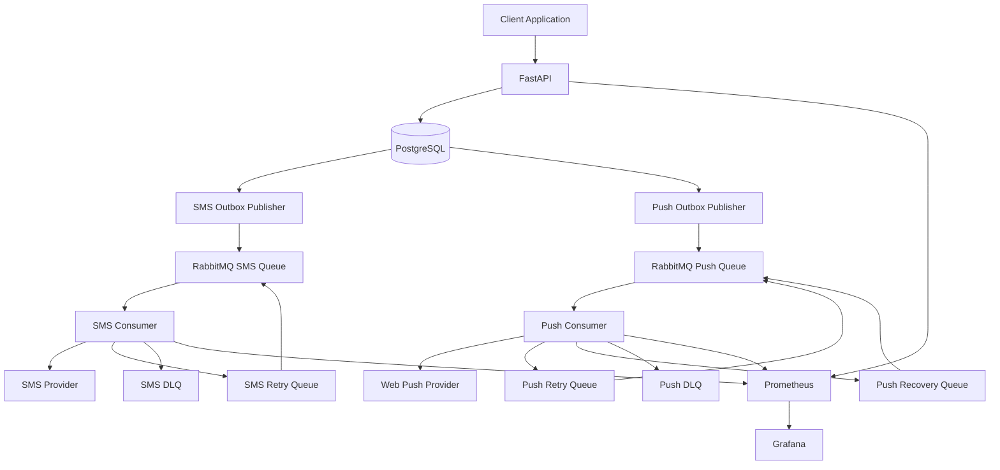

# NotifyFlow 🚀
### Scalable, Event-Driven Notification Platform

NotifyFlow is an asynchronous notification delivery platform built with **Python, FastAPI, PostgreSQL, and RabbitMQ**. It supports SMS and browser Web Push notifications through independent processing pipelines.

The system focuses on reliable event publishing, asynchronous processing, retry handling, idempotency, delivery tracking, and observability.

---

## ✨ Features

- **SMS Notifications:** Submit SMS notifications through a REST API.
- **Web Push Notifications:** Register browser subscriptions and send push notifications.
- **Asynchronous Processing:** Independent background consumers for SMS and Push.
- **Transactional Outbox:** Persist notification events and publish them reliably.
- **Publisher Confirms:** Wait for RabbitMQ broker confirmation.
- **Retry Mechanism:** Handle transient failures using delayed queues.
- **Dead Letter Queues:** Isolate permanently failed or invalid messages.
- **Idempotency:** Prevent duplicate push notification creation.
- **Consumer Inbox:** Track processed SMS events to help prevent duplicate processing.
- **Delivery Receipts:** Process SMS delivery status callbacks.
- **Observability:** Prometheus metrics and Grafana dashboards.
- **Database Migrations:** Alembic-based schema management.

## 🏗️ Architecture



## 🛠️ Technology Stack

| Component | Technology |
|---|---|
| Language | Python |
| API framework | FastAPI |
| Database | PostgreSQL |
| ORM | SQLAlchemy |
| Migrations | Alembic |
| Message broker | RabbitMQ |
| Async messaging | aio-pika |
| SMS provider | MSG91 / Mock Provider |
| Web Push | pywebpush / VAPID |
| Metrics | Prometheus |
| Dashboards | Grafana |
| Validation | Pydantic |
| Testing | Pytest |

## 🔄 Notification Workflows

### SMS Pipeline

1. Client submits an SMS request to FastAPI.
2. API persists the notification and its outbox event.
3. SMS outbox publisher claims pending events.
4. Publisher sends events to RabbitMQ and waits for broker confirmation.
5. SMS consumer processes the message.
6. Configured SMS provider handles the delivery request.
7. Transient failures enter the delayed retry queue.
8. Invalid or exhausted messages are routed to the DLQ.
9. Delivery receipts update notification status.

**SMS queues**

| Queue | Purpose |
|---|---|
| `notifyflow.notifications` | Main queue |
| `notifyflow.retry` | Delayed retry queue |
| `notifyflow.dlq` | Dead letter queue |

The SMS retry delay is 5 seconds, with a maximum of three attempts.

### Web Push Pipeline

1. Browser subscription details are registered through the API.
2. Client submits a push notification.
3. PostgreSQL stores the notification and outbox event atomically.
4. Push outbox publisher publishes the event.
5. Push consumer processes the event.
6. Consumer fans out the notification to registered, non-expired subscriptions.
7. Delivery results are tracked and eligible failures are retried.
8. Failed events are isolated in the push DLQ.

**Push queues**

| Queue | Purpose |
|---|---|
| `notifyflow.push.notifications` | Main queue |
| `notifyflow.push.retry` | Delayed retry queue |
| `notifyflow.push.recovery` | Delivery lease recovery |
| `notifyflow.push.dlq` | Dead letter queue |

The retry delay is 5 seconds. The recovery queue uses a delay based on a 120-second delivery lease.

## 🔐 Reliability and Design Concepts

### Transactional Outbox

Notification creation and outbox event creation happen in the same PostgreSQL transaction.

Separate publisher processes publish pending events to RabbitMQ. Events are marked as published after broker confirmation.

This avoids losing the persisted event when the application commits a notification but cannot immediately publish it.

### Idempotency

The Push API supports the `Idempotency-Key` request header.

- Same key and same payload: returns the existing notification.
- Same key with a different payload: returns HTTP 409.
- PostgreSQL conflict handling protects against concurrent duplicate requests.

### Consumer Inbox

The SMS consumer uses a consumer inbox table with a unique event identifier to help prevent duplicate event processing.

### Retry and Dead Letter Handling

Transient failures are handled through delayed retry queues. Invalid messages and messages that exhaust their retry attempts can be routed to dead letter queues.

## 📡 API Reference

### Core API

| Method | Endpoint | Description |
|---|---|---|
| GET | `/` | Root endpoint |
| GET | `/health` | Health check |
| GET | `/metrics` | Prometheus metrics |
| POST | `/notifications` | Submit SMS notification |
| GET | `/notifications` | List notifications |
| GET | `/notifications/{notification_id}` | Get notification details |
| POST | `/webhooks/dlr` | Receive SMS delivery receipts |

### Push API

| Method | Endpoint | Description |
|---|---|---|
| POST | `/push/subscriptions` | Register or update browser subscription |
| POST | `/push/notifications` | Create push notification |

### Submit an SMS

`POST /notifications`

```json
{
  "to": "+919876543210",
  "message": "Hello from NotifyFlow!",
  "priority": "normal"
}
```

Priority values: `low`, `normal`, `high`.

A successful asynchronous submission returns HTTP `202 Accepted`.

### Register a Browser Subscription

`POST /push/subscriptions`

```json
{
  "endpoint": "https://push-service.example/subscription",
  "keys": {
    "p256dh": "BASE64URL_PUBLIC_KEY",
    "auth": "BASE64URL_AUTH_SECRET"
  }
}
```

Use the actual endpoint and keys generated by the browser Push API. These values are placeholders.

### Create a Push Notification

`POST /push/notifications`

Header:

```http
Idempotency-Key: notification-unique-001
```

Request:

```json
{
  "title": "NotifyFlow",
  "body": "Your notification has arrived!",
  "target_url": "/"
}
```

A newly queued notification returns HTTP `202 Accepted`.

## 📊 Monitoring and Observability

NotifyFlow uses Prometheus and Grafana to monitor application and consumer behavior.

Monitoring includes:

- Application and worker metrics.
- SMS and Push delivery results.
- Consumer processing duration.
- Consumer errors.
- Dead letter queue events.
- Provider attempts.
- Grafana dashboards and alert rules.

Performance evaluation will cover:

- Throughput.
- p50, p95 and p99 latency.
- Delivery success and failure rates.
- Retry and DLQ rates.
- Queue lag.
- Worker concurrency.
- Resource consumption.

**Performance figures will be published only after reproducible benchmark runs.**

## 🧪 Testing

The project includes tests for:

- API endpoints.
- Notification processing.
- SMS provider integration.
- Push API and subscription validation.
- Push consumer behavior.
- Metrics.
- Provider factories.

Run the test suite:

```bash
pytest -v
```

## ⚙️ Configuration

NotifyFlow loads settings from environment variables and a local `.env` file.

| Variable | Purpose |
|---|---|
| `DATABASE_URL` | PostgreSQL connection URL |
| `SMS_PROVIDER` | SMS provider selection |
| `MSG91_AUTH_KEY` | MSG91 authentication |
| `MSG91_TEMPLATE_ID` | MSG91 template |
| `VAPID_PRIVATE_KEY_PATH` | Web Push private key path |
| `VAPID_PUBLIC_KEY` | Web Push public key |
| `VAPID_SUBJECT` | VAPID subject |
| `DLR_WEBHOOK_SECRET` | Delivery receipt webhook secret |
| `RABBITMQ_HOST` | RabbitMQ hostname |
| `RABBITMQ_PORT` | RabbitMQ port |
| `RABBITMQ_USERNAME` | RabbitMQ username |
| `RABBITMQ_PASSWORD` | RabbitMQ password |
| `RABBITMQ_VHOST` | RabbitMQ virtual host |

Never commit `.env`, provider credentials, private keys, or other secrets.

## 🚀 Local Development

### Prerequisites

- Python 3.14 (development environment).
- PostgreSQL.
- RabbitMQ.
- Docker and Docker Compose for monitoring.

Other Python versions have not yet been validated.

### 1. Clone the repository

```bash
git clone https://github.com/ishan4432/notifyflow.git
cd notifyflow
```

### 2. Create a virtual environment

```bash
python -m venv .venv
source .venv/bin/activate
```

### 3. Install dependencies

```bash
pip install -r requirements.txt
```

### 4. Configure environment variables

Create a local `.env` file containing the required database, RabbitMQ, webhook, and provider settings.

### 5. Run database migrations

```bash
alembic upgrade head
```

### 6. Configure RabbitMQ queues

```bash
python scripts/setup_rabbitmq.py
python scripts/setup_push_rabbitmq.py
```

### 7. Start the API

```bash
uvicorn app.main:app --reload
```

API documentation:

- Swagger UI: http://localhost:8000/docs
- ReDoc: http://localhost:8000/redoc

### 8. Start consumers and publishers

Run each command in a separate terminal:

```bash
python -m scripts.consumer
```

```bash
python -m scripts.push_consumer
```

```bash
python -m scripts.outbox_publisher
```

```bash
python -m scripts.push_outbox_publisher
```

Ensure PostgreSQL and RabbitMQ are running and configured first.

### 9. Start monitoring

The monitoring Compose file starts Prometheus and Grafana. It does not start PostgreSQL or RabbitMQ.

Configure `monitoring/grafana.env` locally before starting the stack.

```bash
docker compose -f docker-compose.monitoring.yml up -d
```

Monitoring interfaces:

- Prometheus: http://localhost:9090
- Grafana: http://localhost:3000

## 📁 Project Structure

```text
notifyflow/
├── app/
│   ├── providers/
│   ├── routers/
│   ├── database.py
│   ├── main.py
│   ├── metrics.py
│   ├── models.py
│   ├── push_schemas.py
│   ├── schemas.py
│   └── worker_metrics.py
├── migrations/
│   └── versions/
├── monitoring/
│   ├── grafana/
│   │   ├── dashboards/
│   │   └── provisioning/
│   └── prometheus.yml
├── scripts/
│   ├── consumer.py
│   ├── outbox_publisher.py
│   ├── push_consumer.py
│   ├── push_outbox_publisher.py
│   ├── setup_rabbitmq.py
│   └── setup_push_rabbitmq.py
├── tests/
├── alembic.ini
├── docker-compose.monitoring.yml
├── requirements.txt
└── README.md
```

## 🛠️ Future Improvements

- Reproducible load testing and performance benchmarking.
- Additional reliability and failure-injection testing.
- Deployment automation and container orchestration.
- Expanded operational dashboards and alert validation.
- End-to-end integration testing with real provider environments.

## 👨‍💻 Author

**Ishan Verma**

- GitHub: [@ishan4432](https://github.com/ishan4432)
- Repository: [NotifyFlow](https://github.com/ishan4432/notifyflow)

---

*NotifyFlow — Reliable, asynchronous notification delivery through event-driven architecture.*

